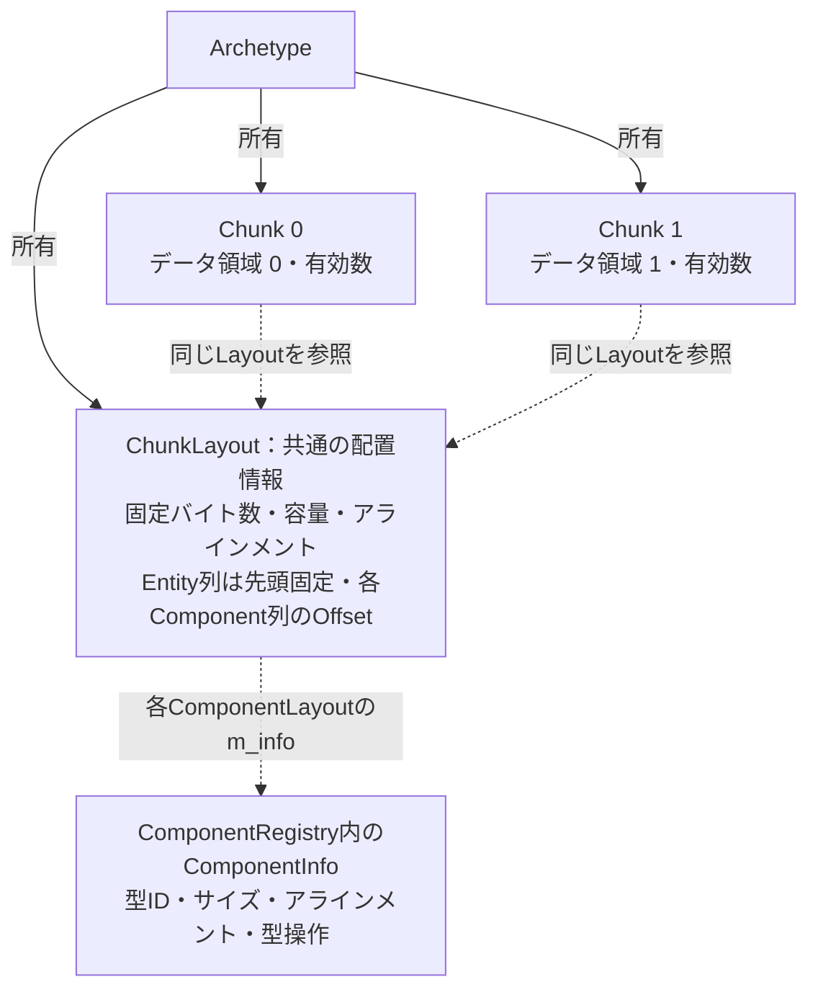

# Archetype
同じComponent構成を持つEntityをまとめるArchetypeのクラスモック。
Chunkを固定バイト数にする方針を前提に、Signature、配置情報、Chunk群の保持を示す。宣言は概念設計用のAPIスケッチ。

## 基本方針
- ArchetypeはComponent IDの集合で識別し、Componentを指定する順序には依存しない。
- 全Signatureに[Name・Tag・Layer](./Entity.md#全entity共通のcomponent)を含める。以下で追加Componentだけを示す構成例は、これらの基本Componentを省略した表記。
- Archetypeが共通のChunkLayoutを持ち、そのLayoutを使用するChunk群を所有する。
- Chunkの保存領域は固定バイト数とし、格納可能なEntity数はComponent構成とアラインメントから算出する。
- 本モックではEntity列とComponent列を固定バイト数の対象とする。Chunkオブジェクトや共通Layoutの管理情報は保存領域の外に置く案。

## LayoutとChunkの関係

**Layoutは配置の設計図で、実データは各Chunkが別々に持つ。** 同じArchetypeでは、この設計図を1つだけ共有する。



実線は所有、破線は非所有参照を示す。ChunkLayout内の`ComponentLayout`はComponent列ごとのOffsetと型情報への参照を持つ。列の中身は持たない。

各Chunkの`m_data`は別のアドレスでも、同じOffsetを加えれば対応する列の先頭を求められる。具体的な保存領域の図は[Chunkの保存領域](./Chunk.md#保存領域)を参照。

## Archetype
**役割**

Component構成、共通の保存配置、所属Chunkを保持する。個々のComponentの実データはChunkが保持する。

```cpp
namespace Hestia
{
    class Archetype
    {
    public:
        Archetype(
            const ComponentRegistry& registry,
            ArchetypeSignature signature,
            size_t chunkByteSize);

        const ArchetypeSignature& GetSignature() const;
        const ChunkLayout& GetLayout() const;

        size_t GetChunkCount() const;
        Chunk& GetChunk(size_t index);
        const Chunk& GetChunk(size_t index) const;

        Chunk& GetOrCreateWritableChunk();

    private:
        ArchetypeSignature m_signature;
        ChunkLayout m_layout;
        std::vector<std::unique_ptr<Chunk>> m_chunks;
    };
}
```

[ComponentRegistry](./ComponentRegistry.md#componentregistry)  
[ArchetypeSignature](#archetypesignature)  
[ChunkLayout](#chunklayout)  
[Chunk](./Chunk.md#chunk)

**所有・参照**：[ECSWorld](./ECSWorld.md#ecsworld)がArchetypeを所有し、ArchetypeはSignature、Layout、Chunk群を所有する。Layout内のComponentInfoはRegistryへの非所有参照。

**APIとメンバ**：生成時にRegistryから型情報を取得し、配置と容量を一度計算する。`GetOrCreateWritableChunk()`は空きのあるChunkを返し、なければ同じLayoutのChunkを追加する。空きChunkの検索方法や回収方針は未確定。

同じArchetypeの全ChunkでLayoutと容量を共有する。Entityの追加・削除によって変わるのは各Chunkの有効数であり、既存の列配置は変えない。

### ArchetypeSignature
---
**役割**

Archetypeに含まれるComponent IDの集合を表す。

```cpp
namespace Hestia
{
    struct ArchetypeSignature
    {
        std::vector<ComponentTypeId> m_types;
    };
}
```

[ComponentTypeId](./ComponentRegistry.md#componenttypeid)

IDを昇順に並べ、重複のない形で保持するモック案。例えば入力順が異なる`Transform + MeshRenderer`と`MeshRenderer + Transform`を同じ構成として扱える。ハッシュIDをビット位置として使う固定長Bitsetにはしない。

Archetype検索用の表や、Signatureのハッシュ方式は後続で決める。検索にハッシュを使う場合も、同一構成かどうかはID列を比較して判断する。

### ChunkLayout
---
**役割**

同じArchetypeのChunkで共有する保存領域のサイズ、容量、列の開始位置を保持する。

```cpp
namespace Hestia
{
    struct ChunkLayout
    {
        size_t m_byteSize;
        size_t m_capacity;
        size_t m_alignment;

        std::vector<ComponentLayout> m_components;
    };
}
```

[ComponentLayout](#componentlayout)  
[Chunk](./Chunk.md#chunk)

- `m_byteSize`：各Chunkが確保する固定バイト数。具体値は未確定。
- `m_capacity`：その保存領域へ配置できるEntity数。同じArchetypeでは共通で、別のArchetypeでは異なり得る。
- `m_alignment`：Entity型と各Component型の配置条件を満たす保存領域の開始アラインメント。
- `m_components`：Component列ごとの配置情報。SignatureのID順に対応させる案。

Entity列は保存領域の先頭`m_data`に固定する。保存領域自体がEntity型のアラインメントを満たすため、Entity列のOffsetは保持しない。

追加の3種類のComponentに注目すると、Layoutは次の情報を保持する。図ではName・Tag・Layerの配置情報を省略するが、容量計算には含める。`B`は固定バイト数、`N`は計算した容量、`O`で始まる値は保存領域先頭からのOffsetを表す。

```text
ChunkLayout（Archetypeが1つ所有）
├─ m_byteSize     = B
├─ m_capacity     = N
├─ m_alignment   = 保存領域の開始アラインメント
└─ m_components
   ├─ [t] ComponentLayout { TransformのID,    OT, 型情報への参照 }
   ├─ [r] ComponentLayout { RendererのID,     OR, 型情報への参照 }
   └─ [m] ComponentLayout { MeshRendererのID, OM, 型情報への参照 }

このLayoutを使う各Chunkの保存領域（Bバイト）
  m_data      → [ Entity × N ]
  m_data + OT → [ Transform × N ]
  m_data + OR → [ Renderer × N ]
  m_data + OM → [ MeshRenderer × N ]
```

列順は説明用。t／r／mは各型に対応する列番号。各列の間には必要なPaddingが入り、基本Componentも含めて全体がBバイト以内に収まるようNとOffsetを決める。Layoutには共通の容量Nを持たせ、有効Entity数は各Chunkが別に保持する。

### ComponentLayout
---
**役割**

1つのComponent列の開始位置と、型の配置・寿命操作情報への参照を保持する。

```cpp
namespace Hestia
{
    struct ComponentLayout
    {
        ComponentTypeId m_type;
        size_t m_offset;
        const ComponentInfo* m_info;
    };
}
```

[ComponentTypeId](./ComponentRegistry.md#componenttypeid)  
[ComponentInfo](./ComponentRegistry.md#componentinfo)

`m_offset`は保存領域先頭から列先頭までのバイト数。各要素の間隔は`m_info->m_size`、列の開始条件は`m_info->m_alignment`を使う。ComponentInfoのサイズや操作情報を列ごとに複製せず参照する。

Transform列のComponentLayoutを取り出すと、配置情報と型情報の関係は次のようになる。

```text
ComponentLayout（Transform列）
├─ m_type   = TransformのComponentTypeId
├─ m_offset = OT
└─ m_info ── 非所有参照 ──→ ComponentRegistry内のComponentInfo
                            ├─ m_id        = TransformのComponentTypeId
                            ├─ m_name      = "Hestia::Transform"
                            ├─ m_size      = sizeof(Transform)
                            ├─ m_alignment = alignof(Transform)
                            └─ 構築・破棄・Move／Copy操作

各Chunk内のTransform列
  m_data + OT → [ T0 ][ T1 ][ T2 ] ... [ T(N-1) ]
                  ← 要素の間隔はm_info->m_size →

  行iのアドレス = m_data + m_offset + i * m_info->m_size
```

同じTransform型を使う別のArchetypeでは、ComponentInfoを共有できても列のOffsetは異なり得る。このため型情報はRegistry、配置情報はArchetypeのLayoutに分けて保持する。

## 容量と配置の算出
---
候補となる容量Nに対して、Entity列と各Component列をSoAで並べる。

1. Entity型のアラインメントを満たす保存領域の先頭へ、N個分のEntity列を置く。
2. 各Component型のアラインメントへ開始位置を切り上げ、`sizeof(T) * N`バイトの列を置く。
3. 最後の列の終端が固定バイト数に収まることを確認する。
4. 条件を満たす最大のNを容量とし、そのNで計算した列オフセットを保存する。

単純に固定バイト数をサイズ合計で割るだけでは、列間のPaddingを考慮できない。保存領域の先頭自体も`m_alignment`に従って確保する。

`std::vector`などのComponentが個別に確保する外部領域は固定バイト数に含めない。Chunk内にはコンテナオブジェクト本体を配置する。

## 未確定事項
---
- Chunkの具体的な固定バイト数と設定API。モックではECSWorldが値を保持してArchetypeへ渡す。
- 1Entity分も収まらない構成の失敗通知。容量0のChunkを通常の保存先にしない。
- [ECSWorld](./ECSWorld.md)によるEntity配置・Archetype検索の具体的な手順。
- Chunkへの追加・削除APIと、Archetype間移動の調停。

Layoutは所属Chunkが存在する間変更しない。Component構成の変更は別のArchetypeへの移動として後続で設計する。Chunkが参照するArchetypeのLayout、およびRegistryの型情報は、Chunk破棄まで保持する。
